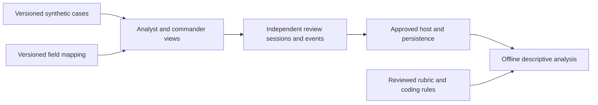

# Proposed study design

Status: implementation guidance for the [proposal](proposal.md) and [specification](specs.md), not a claim that this study exists or is approved. The root [README](../../README.md) describes a broader browser-local visualization prototype. The separate pilot inspected at source commit `7f2722e` compares baseline and recommended displays within participants, not the proposed independent paired commander and analyst reviews. Reuse is subject to a gap review, not assumed equivalence.

## Boundary and components

The smallest proposed system is a versioned synthetic case library, two presentations over the same evidence, a review session and event recorder, an approved persistence boundary, and offline descriptive analysis. Keep the advisor-reviewed rubric out of participant-facing views and assets. Do not introduce operational targeting, real sensitive evidence, or a new recommendation model.

The reVISit adapter and configuration exist at the earlier inspected revision `7f2722e`, but hosted integration and database persistence are unverified. At that revision standalone rehearsal stores sessions in the browser and exports locally. The current local preview notes and workflow both pin `4154d203393bd05f2482e2aabe4cc859b904e9a3`, but the deployed hash remains unverified. Static hosting is not a database. Select and validate the institutional host and storage contract before live collection rather than treating the adapter as proof of deployment.

## Data and interaction

- A case version contains synthetic reports, claims, timestamps, relationships, transformations, recommendations and evidence references. The field mapping identifies analyst presentation and each commander variation's explicit, summarized or drill-down representation and access path. Both reviewers must have access to the same underlying evidence.
- The separate rubric version defines acceptable judgments, defects and stages, decision-relevant fields and scoring rules. Assignment records link a case version and variation to two distinct pseudonymous reviewers without exposing the analyst's response to the commander reviewer.
- Each independently consented review records the judgment, original rationale, defect and stage responses, relevant interactions, timestamps and defined review time. Include session, pair, case, view, variation, mapping, rubric and study version identifiers. Capture drill-down access without equating it to attention or understanding.
- The host interface must define session entry, progression, completion and withdrawal. The persistence interface must acknowledge success, surface recoverable failure and support idempotent retry keyed to a logical submission. Define actual schemas, ownership and recovery behavior with the selected host before implementation.
- Offline analysis combines eligible paired records, versioned mappings, rubric and frozen coding rules. Report agreement, information preservation and correctness with denominators and missingness. Handle zero-field analyst rationales explicitly and report shared incorrect answers separately.

## Tradeoffs and risks

Direct case data and a single mapping avoid a separate service while making version discipline essential. Browser-local rehearsal is simple but cannot provide centrally controlled collection or recovery across devices. A hosted adapter reduces integration work but requires independent end-to-end verification, including session behavior, response export, database access and retries. Multiple representation changes and reviewer differences limit attribution. Synthetic cases and descriptive results do not establish operational validity or universal field requirements.

Prevent inadvertent disclosure through approved pseudonymization, least-privilege access, encryption, retention and deletion policies, and avoid client-side credentials. Treat client-delivered data as inspectable and do not rely on hidden browser assets to protect rubric answers. Test network loss, interrupted sessions, duplicate submissions, missing responses and separation of rehearsal and authorized data. Establish supported browsers, accessibility, availability and data-loss targets before launch. Pilot collection requires institutional determination or approval and approved consent and withdrawal procedures.

## Milestones

1. Confirm protocol, field variations, assignment, case rubric, ownership and institutional requirements.
2. Review the existing pilot and recommender against the proposed protocol, then build and validate the minimum shared-case views and mappings.
3. Implement and test independent review capture and descriptive analysis with synthetic records, including failure and missing-data cases.
4. Validate the selected reVISit host and persistence end to end, complete security and accessibility review and verify the deployed preview revision.
5. Rehearse and obtain all required approvals before recruitment or participant testing. Without approval report methods or feasibility only.
